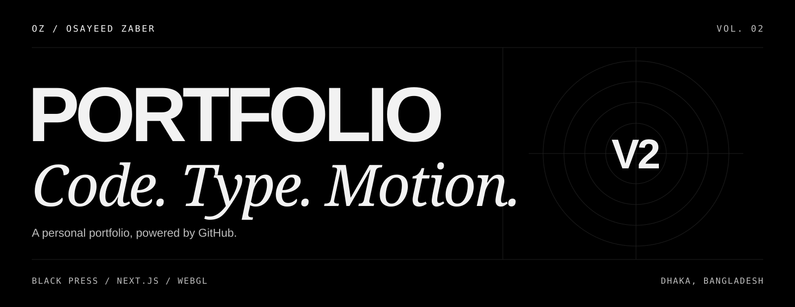
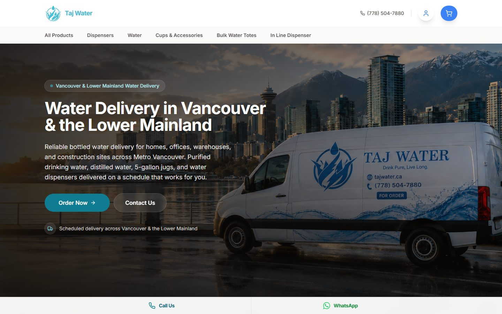
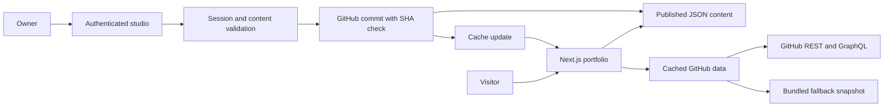

<div align="center">



# Osayeed Zaber · Portfolio V2

**An editorial portfolio with a black canvas, expressive type, and interactive motion.**

Selected work, GitHub activity, a Minecraft workbench, and a private publishing studio.
Built with Next.js 16, React 19, and TypeScript.

[](package.json)
[](package.json)
[](tsconfig.json)
[](src/app/globals.css)
[](pnpm-lock.yaml)

[Experience](#the-experience) · [Selected work](#selected-work) · [Quick start](#quick-start) · [Architecture](#architecture) · [Deployment](#deploy-to-vercel)

</div>

---

## The experience

**Black Press** treats the portfolio like a publication: numbered chapters, generous
typography, hairline rules, and an all-black ground. Bricolage Grotesque carries the
headlines, Instrument Serif adds the asides, and JetBrains Mono handles the labels.
Original-color project screenshots bring the work into focus.

| Chapter | What you will find |
| :--- | :--- |
| **00 / Cover** | Variable typography, a WebGL light tunnel, and animated roles |
| **01 / About** | A personal introduction and reflective portrait card |
| **02 / Work** | A project carousel, Corso Velle showcase, and individual case studies |
| **03 / Toolkit** | Languages, tools, and interests in moving type belts |
| **04 / Ledger** | Real GitHub repositories, languages, and contribution activity |
| **05 / Experience** | A timeline of development, commerce, and community work |
| **06 / Recognition** | Achievements, shown only when real content is available |
| **07 / Workbench** | Ten Minecraft tools and an optional shader and typography lab |
| **08 / Contact** | Social links, email, and a closing typographic footer |

Motion respects reduced-motion preferences. WebGL effects mount near the viewport
and have static fallbacks. Mobile uses its own composition.

## Selected work

A preview of the projects featured inside the portfolio. These are screenshots of
the project websites, rather than screenshots of the portfolio itself.

<table>
  <tr>
    <td width="50%">
      <a href="https://github.com/Osayeidzaber/Corso-Velle-V2"></a>
      <h3>Corso Velle</h3>
      <p>A Shopify Online Store 2.0 theme with editorial shopping, interactive product discovery, and a custom cart.</p>
    </td>
    <td width="50%">
      <a href="https://github.com/Osayeidzaber/tajwater"></a>
      <h3>TajWater</h3>
      <p>A water delivery platform for Metro Vancouver, with subscriptions, delivery tracking, and a role-gated admin panel.</p>
    </td>
  </tr>
</table>

The project index also includes **IGAC**, **ARZ**, **IGAC Certificates**, and
**IGACMUN Session III**. Case studies render repository READMEs on the server,
with bundled copies available when GitHub is unreachable.

## Built to stay editable

**GitHub is the content system.** The private studio at `/admin` edits JSON in this
repository. Publishing creates a commit; history and restore come from Git.

- **Draft before publishing.** Edit sections, reorder entries, upload media, and preview the draft.
- **Protect concurrent edits.** Every save includes the last-seen file SHA; stale saves surface a conflict.
- **Keep the portfolio current.** GitHub data refreshes hourly, with verified webhooks for earlier cache invalidation.
- **Keep content available.** Bundled JSON and a GitHub snapshot provide fallbacks when remote reads fail.
- **Show real information.** Unknown achievements and other placeholders stay hidden on the public site.

The Minecraft workbench runs locally in the browser. Its tools cover coordinate
conversion, gradients, stacks, time, color codes, MOTD previews, chunks, portal
links, XP, and item-name formatting. The visual lab loads when opened.

## Quick start

Use **Node.js 22 or newer** and **pnpm 10.34.9**. The pnpm version is pinned in `package.json`.

```bash
git clone https://github.com/Osayeidzaber/portfolio-v2.git
cd portfolio-v2
pnpm install --frozen-lockfile
pnpm dev
```

Open **[localhost:3000](http://localhost:3000)**. The public site works without
environment variables using bundled content and public GitHub data.

<details>
<summary><strong>Enable the local editing studio</strong></summary>

1. Copy [`.env.example`](.env.example) to `.env.local`.
2. Run `pnpm hash-password` and choose a password of at least 12 characters.
3. Paste the generated `ADMIN_PASSWORD_HASH` and `SESSION_SECRET` into `.env.local`.
4. Restart the development server and sign in at `/admin`.

Without GitHub publishing configured, development saves write local content files.
Production publishing needs a content repository and write token.

</details>

<details>
<summary><strong>Environment variables</strong></summary>

| Variable | Purpose |
| :--- | :--- |
| `NEXT_PUBLIC_SITE_URL` | Canonical production URL for metadata and the sitemap |
| `GITHUB_USERNAME` | Profile to display; defaults to `Osayeidzaber` |
| `GITHUB_TOKEN` | Optional read token for higher API limits and contribution-calendar access |
| `GITHUB_CONTENT_REPO` | `Osayeidzaber/portfolio-v2` for studio publishing to this repository |
| `GITHUB_CONTENT_BRANCH` | Content branch; defaults to `main` |
| `GITHUB_CONTENT_TOKEN` | Fine-grained token with **Contents: read and write** for this repository |
| `ADMIN_PASSWORD_HASH` | Password hash from `pnpm hash-password` |
| `SESSION_SECRET` | Session-signing secret generated by the same command |
| `GITHUB_WEBHOOK_SECRET` | Shared secret for GitHub webhook verification |
| `REVALIDATE_SECRET` | Optional bearer secret for manual cache refresh |

Keep real credentials in `.env.local` or the deployment environment. Tokens,
password hashes, and session secrets stay server-only. Only the canonical site
URL uses the `NEXT_PUBLIC_` prefix.

</details>

## Architecture



| Layer | Technology |
| :--- | :--- |
| **Application** | Next.js 16 App Router, React 19, TypeScript |
| **Interface** | Tailwind CSS 4, shadcn registry components |
| **Motion** | GSAP, ScrollTrigger, Motion |
| **Graphics** | Three.js, React Three Fiber, ogl |
| **Content** | GitHub REST / GraphQL, JSON, Zod |
| **Checks** | Vitest, Playwright, axe accessibility checks |
| **Hosting** | Prepared for Vercel |

<details>
<summary><strong>Explore the source</strong></summary>

```text
content/                 Published content, drafts, uploads, GitHub snapshot
scripts/                 Snapshot sync and password generation
src/app/(site)/          Homepage and /work/[slug] case studies
src/app/admin/           Studio, login, and draft previews
src/app/api/             Webhook, revalidation, and thumbnail endpoints
src/components/site/     Portfolio chapters and composition
src/components/shaders/  Custom shader experiments
src/lib/content/         Schema, storage, validation, and conflicts
src/lib/github/          API clients, ranking, READMEs, and webhook verification
src/lib/auth/            Passwords, signed sessions, and rate limiting
tests/                   Unit tests
e2e/                     Browser and security checks
```

Registry components come from React Bits, Aceternity, Magic UI, Fancy, and UI Arc.
Two unavailable Aceternity Pro blocks were replaced with custom implementations.
See [PLAN.md](PLAN.md) for the complete component map and design decisions, and
[AGENTS.md](AGENTS.md) for contributor conventions.

</details>

## Deploy to Vercel

1. Import [`Osayeidzaber/portfolio-v2`](https://github.com/Osayeidzaber/portfolio-v2) as a Next.js project.
2. Set `NEXT_PUBLIC_SITE_URL` to your production URL.
3. Configure the studio's repository, write token, password hash, and session secret.
   Generate fresh production credentials with `pnpm hash-password`.
4. Add an optional read token for GitHub activity, then deploy.

<details>
<summary><strong>Connect GitHub webhooks and publishing</strong></summary>

Set `GITHUB_WEBHOOK_SECRET` in Vercel, then add a webhook in GitHub repository settings:

| Setting | Value |
| :--- | :--- |
| Payload URL | `https://<your-domain>/api/github/webhook` |
| Content type | `application/json` |
| Secret | The same value as `GITHUB_WEBHOOK_SECRET` |
| Events | Push events |

Add the webhook to featured project repositories for earlier data refreshes after
their pushes. Repositories without a webhook refresh through the hourly cache.

In the studio, use **Save draft → Preview draft → Publish**. Published content
lives in `content/site.json`, drafts in `content/draft.json`, and uploads in
`content/uploads/`. Repository-backed uploads are served through `/media/…` and
can be read before the next deployment completes.

Vercel can deploy pushes to `main` and create previews for pull requests. Redeploy
after changing environment variables.

</details>

## Development and verification

| Command | What it does |
| :--- | :--- |
| `pnpm dev` | Start the development server |
| `pnpm build` | Refresh the GitHub snapshot and build for production |
| `pnpm start` | Serve the production build |
| `pnpm typecheck` | Check TypeScript |
| `pnpm lint` | Run ESLint |
| `pnpm test` | Run unit tests |
| `pnpm test:e2e` | Run desktop and mobile Chromium checks |
| `pnpm hash-password` | Generate studio credentials |
| `pnpm snapshot:github` | Refresh the offline GitHub data |

```bash
pnpm typecheck && pnpm lint && pnpm test && pnpm build && pnpm test:e2e
```

Install the browser with `pnpm exec playwright install chromium` if needed.
Browser tests start a production server on port **3100** by default. Set
`E2E_ADMIN_PASSWORD` to include authenticated studio checks.

<details>
<summary><strong>Verification history and known limitations</strong></summary>

During repository setup on **27 October 2026**, TypeScript, ESLint, 35 unit tests,
and the production build passed. That browser run returned **26 passed, 3 skipped,
and 5 failed**, covering tool alert selectors, duplicate noindex metadata, and
homepage accessibility checks. Files changed during that run; these are historical
results, not a statement that the current checkout passes every check.

- Mobile performance still needs work on low-power devices. Earlier local Lighthouse
  runs measured roughly 60 mobile performance; deployed results may differ.
- Browser automation covers Chromium desktop and mobile emulation. Real devices,
  Safari, and Firefox require separate checks.
- The login rate limiter uses memory and applies per server instance.
- Without `GITHUB_TOKEN`, the Ledger uses a labeled public-events fallback; GitHub
  rate limits can also cause the site to use its bundled snapshot.

</details>

<details>
<summary><strong>Troubleshooting</strong></summary>

| Symptom | Check |
| :--- | :--- |
| Studio login is disabled | Set a password hash and a session secret of at least 32 characters; restart or redeploy |
| Production publishing is unavailable | Check the content repository, selected branch, and write token's repository access and Contents permission |
| GitHub data looks stale | Check the read token and webhook, or run `pnpm snapshot:github` |
| Browser tests cannot start | Build first, install Chromium, and check the test server's port |

</details>

---

<div align="center">

**Designed and built by [Osayeed Zaber](https://github.com/Osayeidzaber).**

Full-stack development · Shopify storefronts · Interactive interfaces
<br />Dhaka, Bangladesh · [Get in touch](mailto:osayeedjaber18@gmail.com)

</div>
